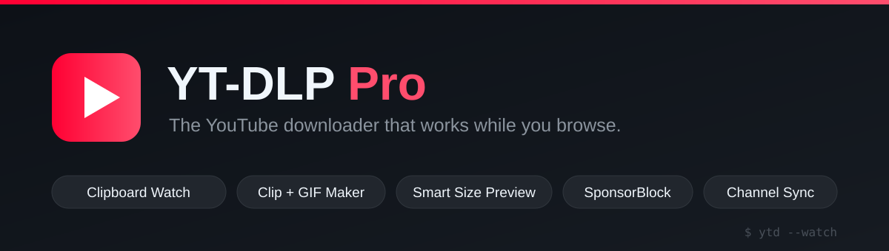
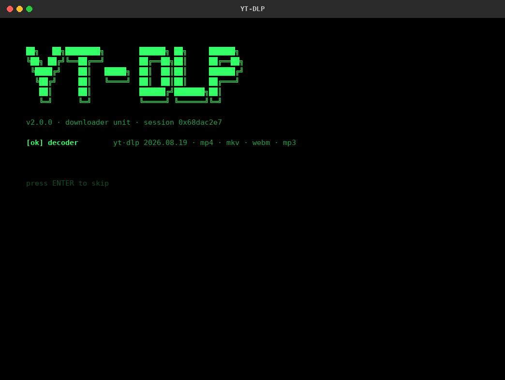
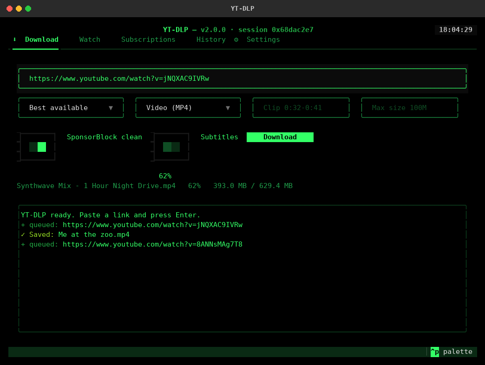
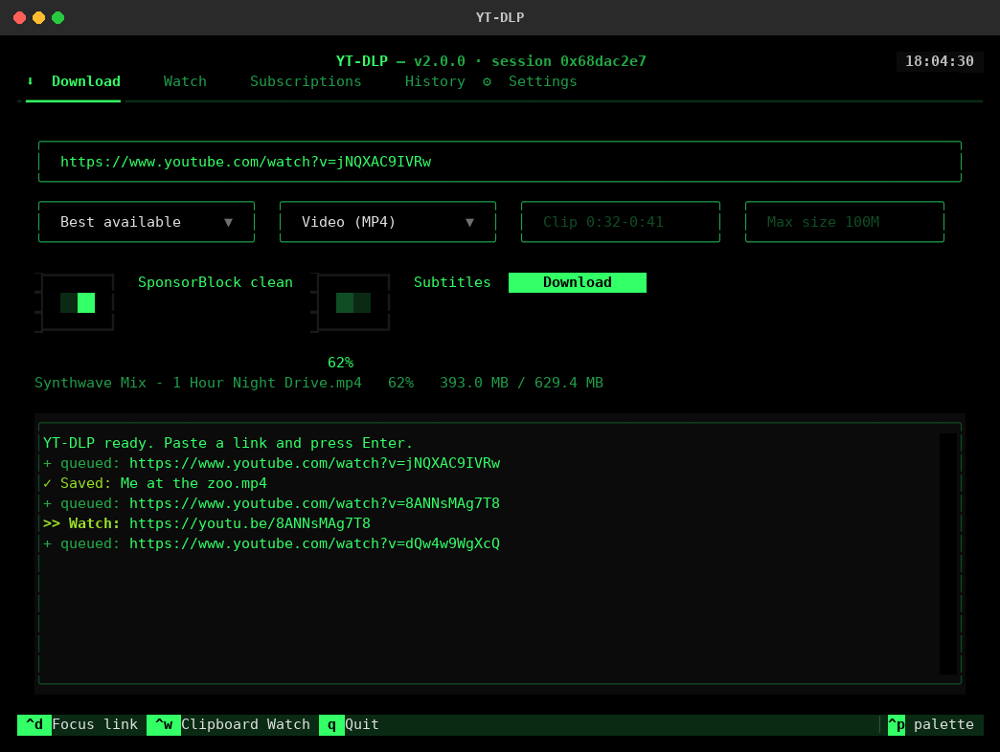
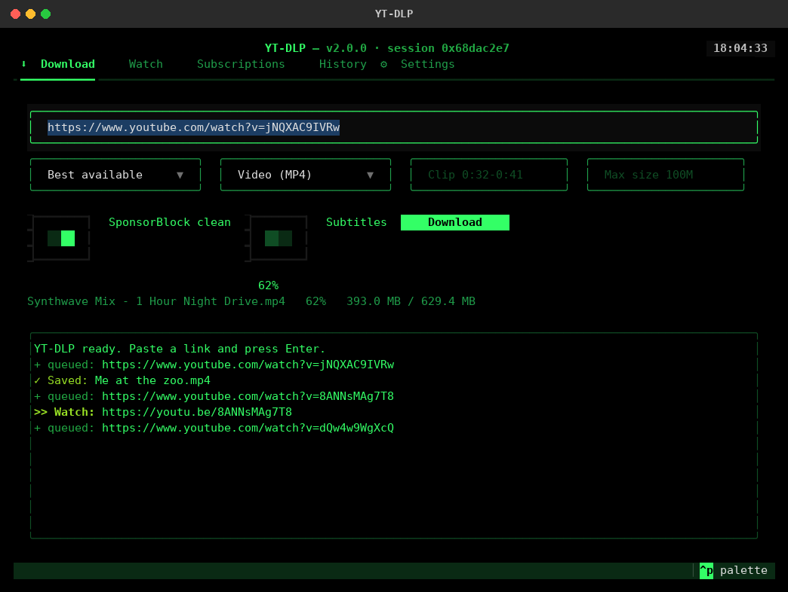
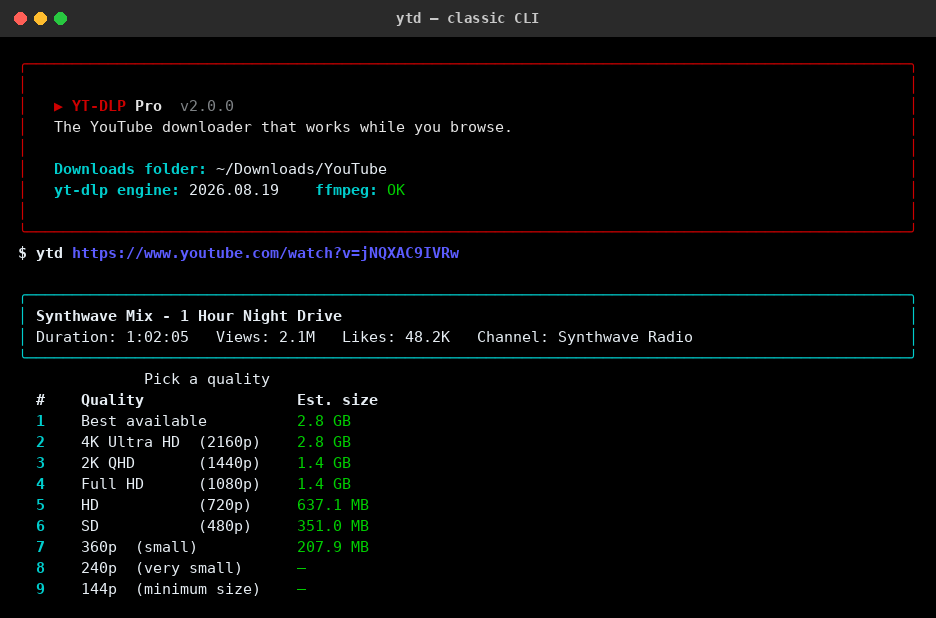

<p align="center">
  
</p>

<p align="center">
  <b>🇬🇧 English</b> · <a href="README-fa.md">🇮🇷 فارسی</a>
</p>

<p align="center">
  <a href="https://github.com/ShayanTxT/ytd-pro/releases"></a>
  
  
  <a href="LICENSE"></a>
  
</p>

<p align="center">
  <b>Copy a link. It downloads itself.</b><br>
  A terminal YouTube downloader for Windows with a clipboard autopilot, a clip &amp; GIF maker,<br>
  smart size previews, SponsorBlock cleaning, and channel subscriptions — in a single file.
</p>

---

## ⭐ Why YT-DLP Pro?

Most "YouTube downloaders" are thin wrappers: paste link, pick quality, wait. YT-DLP Pro does the things they don't:

| Feature | Typical wrappers | **YT-DLP Pro** |
|---|:---:|:---:|
| Downloads start when you *copy* a link (Clipboard Watch) | ❌ | ✅ |
| Download just `0:32–0:41` of a video / turn it into a GIF | ❌ | ✅ |
| See the file size of every quality **before** downloading | ❌ | ✅ |
| "Best quality under 100 MB" automatic mode | ❌ | ✅ |
| Sponsor segments & intros cut out (SponsorBlock) | ❌ | ✅ |
| Follow channels — grab only **new** uploads | ❌ | ✅ |
| Download by search phrase, no URL needed | ❌ | ✅ |
| Several videos in parallel + multi-part speed boost | ⚠️ partial | ✅ |
| 4K→144p, MP3 + cover art, playlists, subtitles | ✅ | ✅ |

---

## 🖼️ Screenshots

<p align="center">
  
</p>

<table>
  <tr>
    <td width="50%"></td>
    <td width="50%"></td>
  </tr>
  <tr>
    <td width="50%"></td>
    <td width="50%"></td>
  </tr>
  <tr>
    <td width="50%"></td>
    <td width="50%"></td>
  </tr>
</table>

---

## ✨ Killer features

### 📋 Clipboard Watch — downloads on autopilot
Run it once, keep browsing. Every video link you copy (YouTube, Instagram, TikTok, X, Vimeo, …) starts downloading automatically in the background terminal.

```powershell
ytd --watch            # now just copy links anywhere. That's it.
ytd --watch -a         # same, but everything becomes MP3
```

### ✂️ Clip & GIF maker
Grab only the moment you need — only those seconds are downloaded (frame-accurate cuts):

```powershell
ytd <URL> --clip 0:32-0:41            # a 9-second MP4 clip
ytd <URL> --clip 1:02-1:07 --gif      # that moment as an optimized GIF
ytd <URL> --clip 45-90 -a             # an MP3 snippet (ringtone anyone?)
```

### 📏 Smart size preview & size cap
No more "surprise, that 4K file was 3 GB". The quality picker shows estimated sizes, and Smart mode picks for you:

```powershell
ytd <URL> --max-size 100M    # best quality that fits in 100 MB
ytd <URL> --max-size 1.5G
```

### 🚫 SponsorBlock cleaning
Community-flagged sponsor segments, self-promos and interaction bait are cut from the file itself:

```powershell
ytd <URL> --clean                       # sponsor + selfpromo + interaction
ytd <URL> --sb sponsor,intro,outro      # you choose the categories
```

### 🔔 Channel subscriptions (offline DVR)
Follow channels once; one command fetches only what you don't have yet. Duplicates are impossible thanks to a persistent download archive.

```powershell
ytd --subscribe https://www.youtube.com/@SomeChannel --name "SomeChannel"
ytd --sync          # downloads only NEW uploads from every subscription
```

### 🔎 Search & grab — no URL needed
```powershell
ytd "lofi hip hop radio"        # downloads the top search result
ytd --search "python tutorial" -q 720
```

### ⚡ Parallel engine
Multiple videos at once (`--workers 4`), parallel fragment downloading inside each file, resume-on-interrupt, and an optional [aria2c](https://aria2.github.io/) accelerator.

…plus everything you'd expect: 4K→144p quality control, MP3 mode with embedded cover art & metadata, playlists with ranges (`--items 1:10`), subtitles (sidecar or embedded), chapter splitting for albums/podcasts, batch files (`--file links.txt`), download history, and browser-cookie support for restricted videos. Works on **1000+ sites** supported by yt-dlp, not just YouTube.

---

## 🖥️ Platforms

| OS | Status | How to install |
|---|---|---|
| Windows 10 / 11 | ✅ Supported (primary target) | `install.bat`, standalone `.exe`, or pip |
| Linux (Ubuntu, Debian, Mint, Fedora, Arch — x86_64) | ✅ Supported | `./install.sh`, standalone binary, or pip |
| macOS | 🧪 Experimental — not officially tested | pip or source |

## 📦 Installation

> **Requirements:** Windows 10/11. [FFmpeg](https://ffmpeg.org/) is needed for HD merging, MP3 and GIFs — the one-click installer and the instructions below cover it.

### Option A — Standalone EXE (easiest, no Python)
1. Download `YT-DLP-Pro.exe` from the [**Releases**](../../releases) page.
2. Install FFmpeg once: `winget install Gyan.FFmpeg`
3. Run it: `YT-DLP-Pro.exe <link>` — or just double-click for the menu.

> 💡 Rename it to `ytd.exe`, drop it in a folder on your PATH (e.g. `C:\Tools`), and every terminal gains the `ytd` command.

### Option B — One-click installer (from source)
1. Download/clone this repo.
2. Run **`install.bat`** — it installs Python, FFmpeg and all libraries, builds a virtual environment, and creates a desktop shortcut.
3. Launch via the desktop icon or `YT-DLP-Pro.bat <link>`.

### Option C — pip
```powershell
git clone https://github.com/ShayanTxT/ytd-pro.git
cd ytd-pro
pip install .
ytd <link>
```

### Option D — Plain Python
```powershell
pip install -r requirements.txt
python yt_downloader.py <link>
```

---

### Linux

```bash
git clone https://github.com/ShayanTxT/ytd-pro.git
cd ytd-pro
./install.sh            # venv + libraries + `ytd` and `YT-DLP` commands + desktop entry
ytd https://youtu.be/xxxxxxxxxxx
```

- Needs **Python 3.10+**. On Debian/Ubuntu also install `python3-venv` if the installer asks for it.
- Install **ffmpeg** for HD merging, MP3, clips and GIFs: `sudo apt install ffmpeg` (Fedora: `sudo dnf install ffmpeg`, Arch: `sudo pacman -S ffmpeg`).
- Clipboard Watch needs `xclip` (X11) or `wl-clipboard` (Wayland), plus `pip install pyperclip`.
- Uninstall with `./install.sh --uninstall` (your downloads and settings are kept).
- Standalone binary: download `ytd-linux-x86_64` from [Releases](../../releases), run `chmod +x ytd-linux-x86_64`, then start it. The binary is built on Ubuntu 22.04, so it runs on distributions with glibc 2.35 or newer.
- Installing with pip on Ubuntu 23.04+ (system Python is locked): use `pipx install .`. `pip install .` provides the `ytd` command on every platform.

## 🖥️ Full-screen terminal UI

Type **`YT-DLP`** in any terminal (CMD, PowerShell or Windows Terminal) and the full-screen interface opens:

- **Download** — paste a link or type a search phrase, pick quality and MP3/MP4, add a clip, a size cap, SponsorBlock or subtitles, and watch the live progress bar.
- **Watch** — toggle Clipboard Watch; copied links are queued and downloaded one by one.
- **Subscriptions** — follow channels, sync new uploads, remove entries.
- **History** — browse everything you have downloaded.
- **Settings** — downloads folder, parallel parts and videos, SponsorBlock default.

Shortcuts: `Ctrl+D` focus the link box · `Ctrl+W` toggle Clipboard Watch · `Q` quit.
Prefer the old text menu? Run `ytd --classic`.

> `install.bat` registers the `YT-DLP` command automatically. For the standalone EXE, copy it into a folder on your PATH and name it `YT-DLP.exe`.

## 🚀 Quick start

```powershell
ytd                                  # interactive menu
ytd https://youtu.be/xxxxxxxxxxx     # instant download, best quality
ytd <URL> -q 720                     # 720p
ytd <URL> -a                         # MP3 only (320 kbps + cover art)
ytd <PLAYLIST_URL> -p                # whole playlist, neatly numbered
ytd <URL> -s                         # with EN/FA subtitles
ytd --file links.txt --workers 4     # batch, 4 at a time
```

### Interactive menu
```
What do you want to do?
   1  Quick download (best quality)
   2  Download with quality + size preview
   3  Audio only (MP3)
   4  Playlist download
   5  Clip / GIF maker        (grab just a piece of a video)
   6  Search & download       (no link needed)
   7  Clipboard Watch mode    (copy a link -> auto-download)
   8  Subscriptions           (auto-grab new uploads)
   9  Download history
  10  Open downloads folder
  11  Settings
   0  Exit
```

Downloads land in `C:\Users\<you>\Downloads\YouTube` by default (changeable in Settings). Playlists get their own numbered subfolder.

### All CLI options

| Option | Description |
|---|---|
| `-a`, `--audio` | Audio only — MP3 320 kbps with cover art & metadata |
| `-q` | Quality: `best` `2160` `1440` `1080` `720` `480` `360` `240` `144` |
| `--max-size 100M` | Auto-pick best quality under the size cap (`K`/`M`/`G`) |
| `-f` | Raw yt-dlp format selector, e.g. `-f 137+140` |
| `--list-formats` | Show every available format of a video |
| `-p`, `--playlist` | Download the whole playlist |
| `--items 1:10` | Playlist item range |
| `--file links.txt` | Batch download (one URL per line) |
| `--workers N` | Download N videos simultaneously |
| `--archive` | Skip anything downloaded before (persistent) |
| `-s`, `--subs` | Subtitles next to the video (EN/FA) |
| `--embed-subs` | Embed subtitles into the file |
| `--clip 0:32-0:41` | Download only that time range |
| `--gif` | Also convert the result/clip to GIF |
| `--split-chapters` | One file per chapter (albums, podcasts) |
| `-C`, `--clean` | Remove sponsor/self-promo segments (SponsorBlock) |
| `--sb sponsor,intro` | Custom SponsorBlock categories |
| `--watch` | Clipboard Watch mode |
| `--search "..."` | Search YouTube, download top result |
| `--subscribe <URL>` | Follow a channel/playlist |
| `--sync` | Download new uploads from all subscriptions |
| `--subscriptions` / `--unsubscribe` | Manage subscriptions |
| `--browser-cookies chrome` | For age-restricted/members videos |
| `-o` | Output folder |
| `--history` | Show download history |
| `--classic` | Use the classic text menu instead of the full-screen UI |
| `--update` | Update the yt-dlp engine (fixes most errors!) |
| `-h`, `-v` | Help / version |

---

## 🛠️ Troubleshooting

| Problem | Fix |
|---|---|
| Random download errors | 90% of cases: `ytd --update` (YouTube changes constantly; yt-dlp must stay current) |
| "ffmpeg not found" / video has no audio | `winget install Gyan.FFmpeg`, then reopen the terminal |
| Age-restricted / "sign in" errors | `ytd <URL> --browser-cookies chrome` (be logged into YouTube in that browser) |
| Download interrupted | Just run the same command again — it resumes |
| Slow downloads | Settings → raise *parallel parts* to 16, or enable aria2c (`winget install aria2.aria2`) |
| Clipboard Watch on a PC without pyperclip | The built-in Win32 clipboard reader kicks in automatically |
| Clipboard Watch does nothing on Linux | Install `xclip` (X11) or `wl-clipboard` (Wayland), then `pip install pyperclip` |

---

## 🏗️ Building the EXE yourself

Run **`build_exe.bat`** — produces `dist\YT-DLP-Pro.exe`, a single self-contained file.
Pushing a version tag (`git tag v2.0.0 && git push --tags`) also triggers the
included GitHub Actions workflow that builds the EXE and attaches it to a Release automatically.

## 📁 Project structure

```
ytd-pro/
├── yt_downloader.py        ← core engine + classic CLI/menu (single file)
├── ytd_tui.py              ← full-screen terminal UI (Textual)
├── tests/test_core.py      ← unit + TUI tests (pytest)
├── install.sh              ← Linux installer (and --uninstall)
├── build.sh                ← Linux single-file binary
├── install.bat             ← Windows one-click installer
├── YT-DLP-Pro.bat          ← Windows launcher
├── build_exe.bat           ← Windows EXE builder
├── pyproject.toml          ← pip packaging (`ytd` command)
├── requirements.txt
├── links.example.txt       ← batch-download example
├── assets/                 ← banner and screenshots
└── .github/                ← CI, release workflow, issue templates
```

User data (settings, history, subscriptions, archive) lives in `~/.ytdpro/`.

## 🤝 Contributing

Issues and PRs are welcome — see [CONTRIBUTING.md](CONTRIBUTING.md). The codebase is intentionally a single readable Python file; grep for `_build_opts` to see how all download options flow through one place.

## ⚖️ Disclaimer

For personal, offline use only. Downloading copyrighted content may violate the terms of service of the respective platforms and/or local law — you are responsible for what you download. This project is not affiliated with YouTube or Google.

## 📄 License

[MIT](LICENSE) © shayan.txt

Built on the shoulders of giants: [yt-dlp](https://github.com/yt-dlp/yt-dlp), [Rich](https://github.com/Textualize/rich), [SponsorBlock](https://sponsor.ajay.app/), and FFmpeg.
